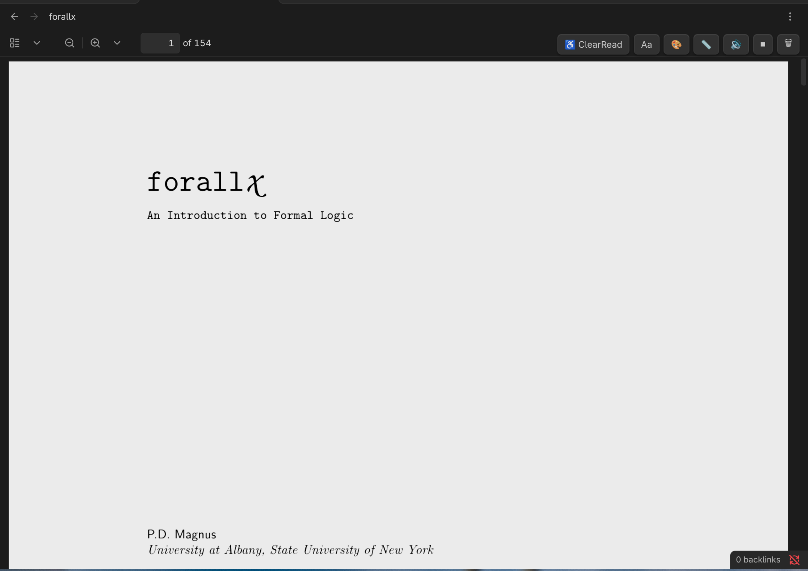
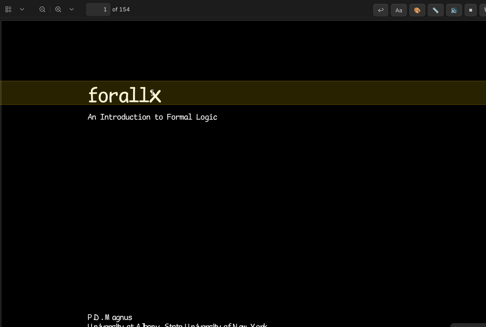

# ClearRead PDF

ClearRead PDF is an accessibility-focused PDF reading plugin for Obsidian. It rewrites the font data inside a cached copy of your PDF so the native viewer renders with an easier-to-read typeface, while search, copy, links, and images keep working.

## Before and after

| Before | After |
| :---: | :---: |
|  |  |
| Default PDF view | Dark background, reading ruler, and accessible font |

What changes in the **After** screenshot:

- **Background color** — the theme control switches the page to a low-glare dark background.
- **Reading ruler / highlighter** — a movable highlight band helps you keep your place on the page.
- **Font change** — font data is substituted in a cached copy, so the text uses a more legible typeface without touching your original PDF.

## Who it is for

- Dyslexia
- ADHD
- Visual stress
- Low vision
- Reading fatigue
- Cognitive overload

## Features

- Font substitution inside a cached copy of the PDF
- Instant font switching for all pages
- Custom font support, downloadable dyslexia-friendly presets, and fallback font chains
- Background themes: dark, sepia, high contrast, and gray
- Reading ruler and focus-mask modes
- Auto-friendly mode that opens a transformed copy whenever you open a PDF
- Basic read-aloud support, including optional natural-voice audio
- Local extraction cache for faster reopening

## Installation

**Requirements:** Obsidian 1.5.0 or newer. This plugin is desktop only.

ClearRead PDF is installed manually. Build it from source and copy the output into your vault's plugin folder.

### 1. Build the plugin

```bash
git clone https://github.com/prashantstha17/obsidian-clearread.git
cd obsidian-clearread
npm install
npm run build
```

### 2. Copy it into your vault

Create the plugin folder inside your vault and copy the required files into it:

```bash
mkdir -p "/path/to/your/vault/.obsidian/plugins/clearread-pdf"
cp main.js manifest.json styles.css AtkinsonHyperlegible-Regular.ttf \
  "/path/to/your/vault/.obsidian/plugins/clearread-pdf/"
```

On Windows, use the same layout with backslashes, for example:

```powershell
mkdir "C:\path\to\your\vault\.obsidian\plugins\clearread-pdf"
copy main.js,manifest.json,styles.css,AtkinsonHyperlegible-Regular.ttf "C:\path\to\your\vault\.obsidian\plugins\clearread-pdf"
```

### 3. Enable it

1. Restart Obsidian.
2. Open **Settings → Community plugins**.
3. Turn off Restricted Mode if needed, then enable **ClearRead PDF**.

The first time you open a PDF, ClearRead builds a local cache; later opens are faster. Your original PDF is never modified. The `pdf.worker.min.js` file is not required by the current build.

## Updating

From your clone of the repository:

```bash
git pull
npm install
npm run build
```

Then copy the updated files into your vault again:

```bash
cp main.js manifest.json styles.css AtkinsonHyperlegible-Regular.ttf \
  "/path/to/your/vault/.obsidian/plugins/clearread-pdf/"
```

Reload Obsidian (or disable and re-enable the plugin) to pick up the new version. Your ClearRead settings are preserved across updates.

## Usage

1. Open any PDF in Obsidian.
2. Click the **ClearRead** button in the PDF toolbar.
3. Use the toolbar buttons to change the theme (`🎨`), reading ruler (`📏`), or font (`Aa`).
4. Open the plugin settings for spacing, presets, custom fonts, and read-aloud options.

## Privacy

ClearRead PDF processes PDF files locally inside Obsidian. It does not send your documents to external servers.

## Limitations

- This plugin does not modify the original PDF file. It extracts text locally and renders a cached copy in a more accessible way.
- Scanned PDFs may need OCR before their text can be read properly.
- PDFs that use unusual embedded fonts or complex layouts may fall back to the original font for some text.

## Development

Install dependencies and start the watch build:

```bash
npm install
npm run dev
```

Create a production build:

```bash
npm run build
```

## License

No license has been added to this repository yet.
